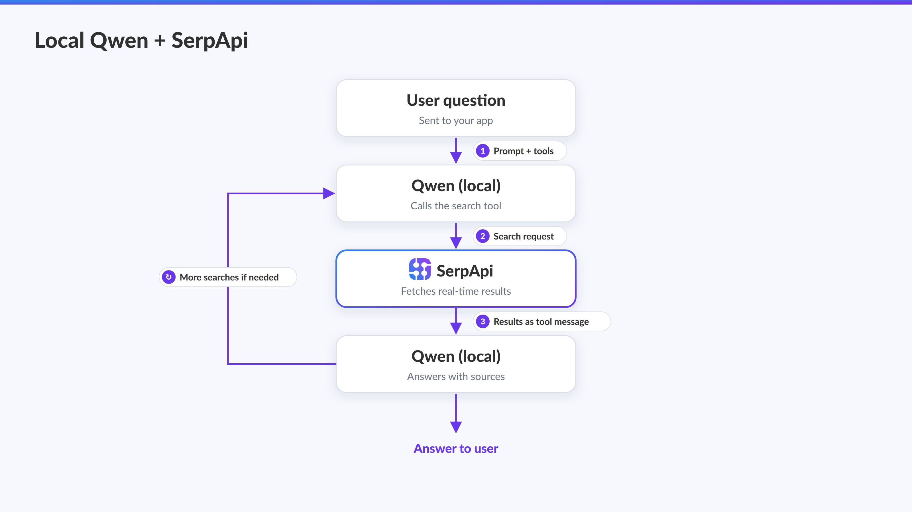
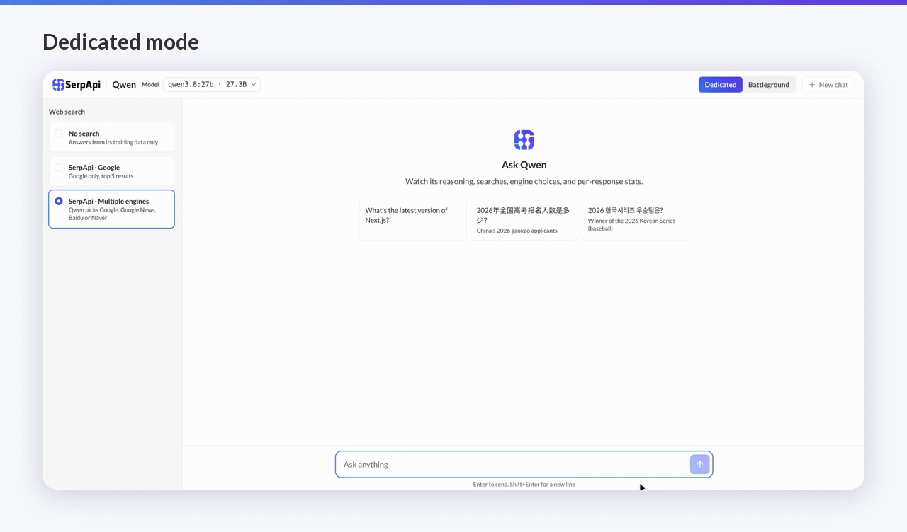
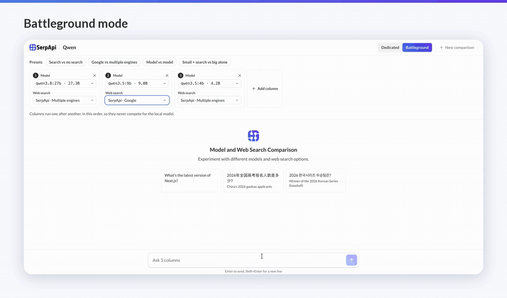

# Web search for Qwen models using SerpApi

Run Qwen on your device with web search through [SerpApi](https://serpapi.com/).



- **[Chat app](#use-the-app)** (`app/`): Ask questions in your browser, see every search Qwen makes, and compare models and web search options Battleground mode.
- **[Examples](#run-the-examples)** (`examples/`): Sample Python scripts to connect Qwen with SerpApi.
- **[Benchmark](#benchmark)** (`app/benchmark/`): Three tests with 100 questions each, our results and what we learned.

## Quick start

You need [Ollama](https://ollama.com/download), Python 3.10 or newer, Node.js 20 or newer (to build the chat app), and a [SerpApi API key](https://serpapi.com/manage-api-key). The free plan includes 250 searches a month.

**1. Install.** Then open `.env` and set `SERPAPI_API_KEY` to your key.

```bash
git clone https://github.com/serpapi/qwen-web-search.git
cd qwen-web-search
python3 -m venv .venv && source .venv/bin/activate
pip install -r requirements.txt
cp .env.example .env
```

**2. Get a Qwen model and start Ollama** in its own terminal. If the Ollama app is open, quit it first.

```bash
ollama pull qwen3.5:9b
OLLAMA_CONTEXT_LENGTH=32768 OLLAMA_FLASH_ATTENTION=1 OLLAMA_KV_CACHE_TYPE=q8_0 ollama serve
```

The settings give Qwen room for search results (a 32k-token context) while keeping memory use down.

**3. Build the UI and start the app** in another terminal:

```bash
cd app/web && npm install && npm run build && cd ..
python server.py
```

Open http://localhost:8000. The first start downloads Qwen's tokenizer from Hugging Face, which the app uses to count search tokens.

### Pick a model

Pull the one that fits your computer's memory:

| Model | Download size | Memory needed |
|---|---|---|
| qwen3.5:4b | 3.4 GB | 6 GB |
| qwen3.5:9b | 6.6 GB | 8 GB |
| qwen3.8:27b | 18 GB | 24 GB |

Any Qwen model with the [tools tag on Ollama](https://ollama.com/search?c=tools&q=qwen) works. The app lists every Qwen model you've pulled and starts with the biggest. To start with a different one, set `LOCAL_MODEL` in `.env`.

## Use the app

The app has two modes:
 - Dedicated
 - Battleground

**Dedicated:** Choose a model and a web search option, then type a question or click an example prompt. Each search appears as a card while Qwen works, with:

- Search engine chosen by Qwen and its search query
- **What Qwen read**: Search results received by Qwen
- Token usage and time taken for the search

The **Answer stats** panel adds up the searches, tokens and time for each answer.



**Battleground:** Compare up to 4 Qwen models with different web search options side by side. Presets fill the columns in one click:

| Preset | Columns |
|---|---|
| Search vs no search | Your model with SerpApi, and without search |
| Google vs multiple engines | Your model with SerpApi · Google, and with SerpApi · Multiple engines |
| Model vs model | Every Qwen model you've pulled (up to four), each with SerpApi |
| Small + search vs big alone | Your smallest model with SerpApi, and your biggest without search |

A table compares the engines used, searches, tokens and total time, and highlights the lowest search tokens and the fastest column. Columns run one after another, so they don't compete for your computer's memory. The time shown doesn't include loading a model.



### Web search options

| Option | Where the search results come from |
|---|---|
| No search | Nowhere. Qwen answers from its training data. |
| SerpApi · Google | Google, through SerpApi, like [`qwen_search.py`](examples/qwen_search.py) |
| SerpApi · Multiple engines | Qwen chooses Google, Google News, Baidu or Naver for each search, like [`qwen_search_multi_engines.py`](examples/qwen_search_multi_engines.py) |

The SerpApi options get the top 5 results as Markdown. To change that, edit `app/serpapi_search.py`. In the app, Qwen can also limit a Google search to the past day, week, month or year when a question is about recent events. The search card shows a badge such as "Past week" next to the engine name. The examples leave this out to stay short.

### Chat in the terminal

From `app/`, run `python chat.py` to chat in the terminal, with Qwen choosing the SerpApi engine.

## Run the examples

Each example is one file. Set `MODEL` at the top of the file to the model you pulled, then run it from the repository root:

```bash
python examples/qwen_search.py
python examples/qwen_search_multi_engines.py
```

| File | What it does |
|---|---|
| [`qwen_search.py`](examples/qwen_search.py) | Qwen searches Google. |
| [`qwen_search_multi_engines.py`](examples/qwen_search_multi_engines.py) | Qwen chooses Google, Google News, Baidu or Naver for each search. |

Type a question after `You:`. A `[search]` line appears for each search Qwen makes before it answers. Press Ctrl+C to quit.

## Benchmark

Three tests with 100 questions each, in English, Chinese and Korean: which model searches best, Google alone vs multiple engines, and a small model with search vs a big model without it. In our runs, a 4B model with search beat a 27B model answering from memory on old facts.

See the [results and how to run the tests](app/benchmark/README.md), the [methodology](app/benchmark/methodology.md) and the [insights](app/benchmark/insights.md).

## Project structure

```
qwen-web-search/
├── examples/
│   ├── qwen_search.py                # Google search in one file
│   └── qwen_search_multi_engines.py  # Qwen chooses the SerpApi engine
├── app/
│   ├── server.py                     # Web server for the chat UI
│   ├── chat.py                       # Search loop with local Qwen, and the terminal chat
│   ├── models.py                     # The installed Qwen models, and the default one
│   ├── tools.py                      # The prompt and search tools Qwen sees
│   ├── serpapi_search.py             # SerpApi search
│   ├── setups.py                     # The web search options shared by the UI and the benchmark
│   ├── bench.py, report.py           # Benchmark and result tables
│   ├── benchmark/                    # Benchmark questions, results and insights
│   └── web/                          # React chat UI
├── assets/                           # Images
├── .env.example
└── requirements.txt
```

## Development

To work on the UI, run `python server.py` in `app/` and `npm run dev` in `app/web/` at the same time, then open http://localhost:5173. Restart `server.py` after you change Python files.

## Troubleshooting

| Problem | Fix |
|---|---|
| `address already in use` when you start Ollama | Ollama is already running. Quit the Ollama app, then start Ollama again. |
| `Can't reach Ollama` | Ollama isn't running. Start it as in [Quick start](#quick-start), then start the app. |
| `Ollama doesn't have ...` or `model "..." not found` | Pull the model with `ollama pull`, or set `LOCAL_MODEL` (app) or `MODEL` (examples) to a name from `ollama list`. |
| The app says no Qwen model was found | Pull one, for example `ollama pull qwen3.5:9b`, then reload the page. Only Qwen models with tool support are listed. |
| `SERPAPI_API_KEY isn't set` | Create `.env` in the repository root, as in [Quick start](#quick-start). |
| A search says `Search failed: Invalid API key` | The key in `.env` is wrong. Copy it again from your [SerpApi dashboard](https://serpapi.com/manage-api-key). |
| A search says `Search failed: Your account has run out of searches` | You've used this month's searches. Check your usage on the [SerpApi dashboard](https://serpapi.com/dashboard). |
| Your computer slows down while Qwen answers | Close other apps or pick a smaller model. Run `ollama stop <model>` to free the memory. |

## Learn more

**SerpApi**

- [Google Search API](https://serpapi.com/search-api), [Google News API](https://serpapi.com/google-news-api), [Baidu Search API](https://serpapi.com/baidu-search-api) and [Naver Search API](https://serpapi.com/naver-search-api): Search engines provided to Qwen in this app
- [Markdown output](https://serpapi.com/markdown-output) and [JSON Restrictor](https://serpapi.com/json-restrictor): For token-efficient web search
- [SerpApi Python SDK](https://github.com/serpapi/serpapi-python): Official SerpApi Python library used in the code
- [How to Connect Your Local LLM with Web Search Data](https://serpapi.com/blog/how-to-connect-your-local-llm-with-web-search-data/) (SerpApi blog)

**Ollama**

- [Tool calling](https://docs.ollama.com/capabilities/tool-calling): How models downloaded from Ollama request a search
- [OpenAI compatibility](https://docs.ollama.com/api/openai-compatibility): The API used in the app and examples
- [FAQ](https://docs.ollama.com/faq): Server settings such as the context window

**Qwen**

- [qwen3.5](https://ollama.com/library/qwen3.5) and [qwen3.8](https://ollama.com/library/qwen3.8) on Ollama: Model sizes and tags
- [Function calling](https://qwen.readthedocs.io/en/latest/framework/function_call.html) in the Qwen docs
